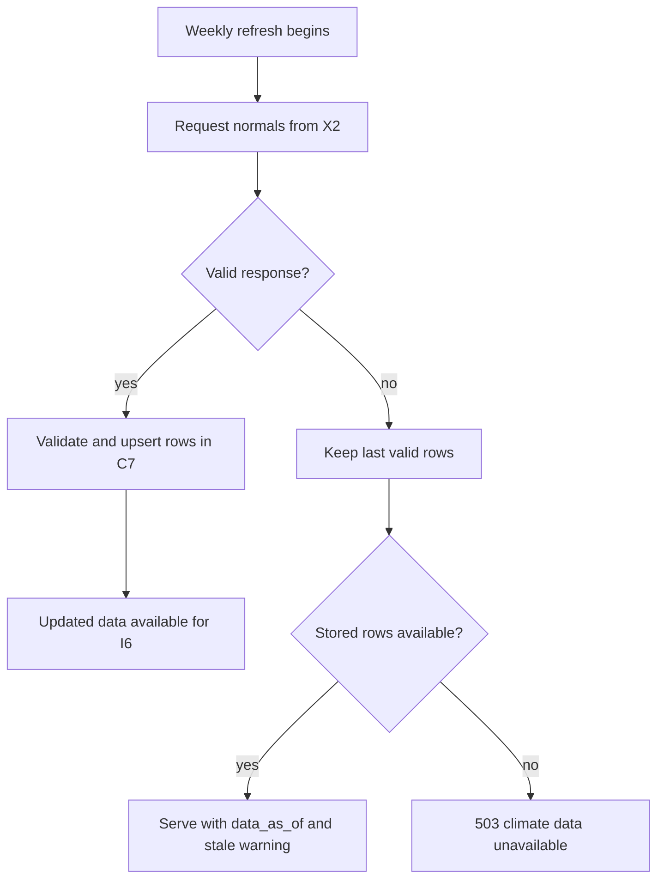
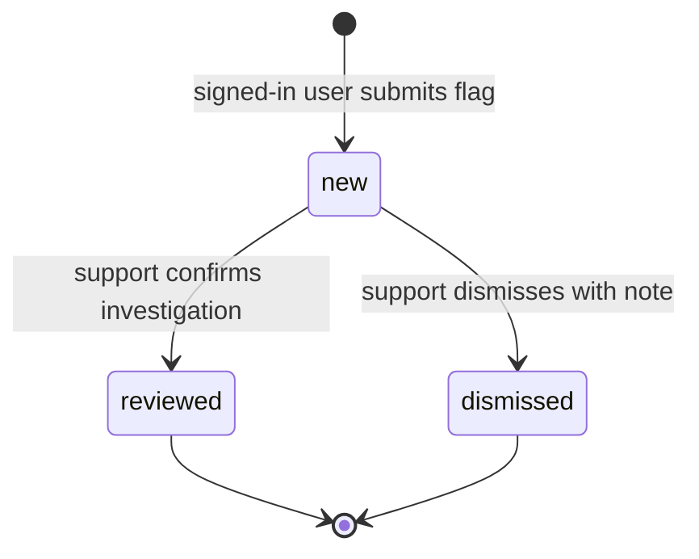
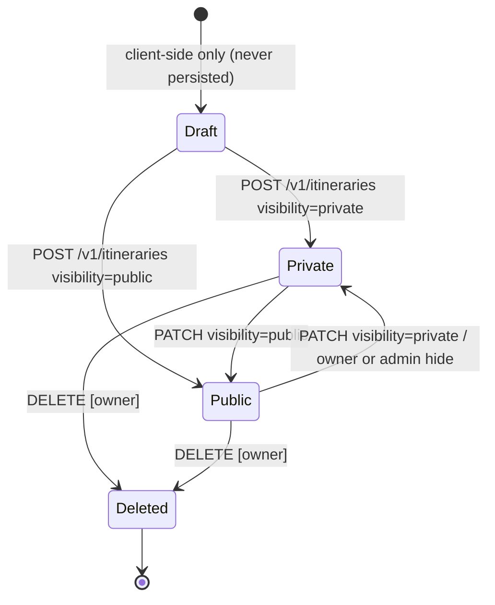
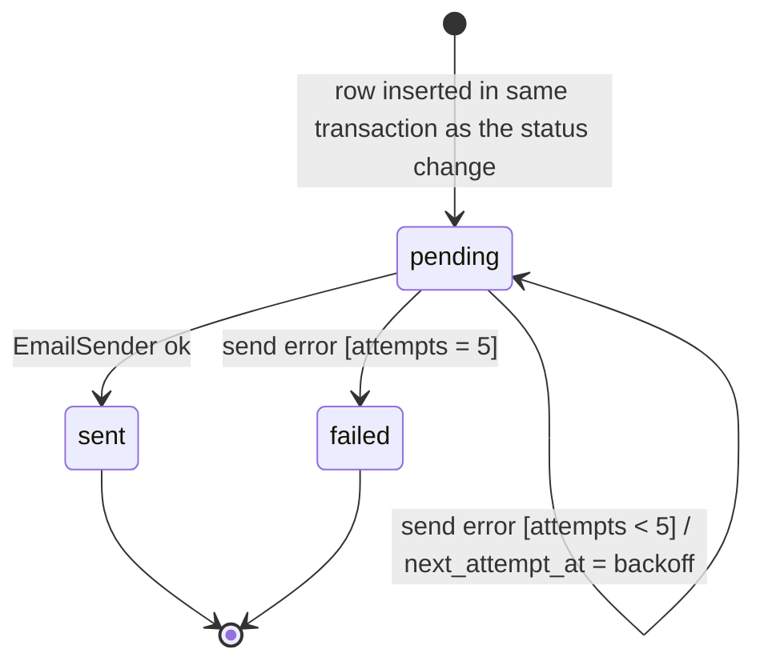

# Voya - D2 Detailed Design

Design D2 | Assignment #4 | October 14, 2026 | Team: Tessneem Khalil and Salwa Syed

---

## 1. Header, Conventions, and D2 Overview

**Project:** Voya
**Goal:** Voya is a social platform for travelers to share trip reviews, recommendations, itineraries, and costs in one place. People can see where others traveled during different months and use their experiences to plan a trip that fits their budget.

The title, goal, and notation are repeated in each D2 figure caption.

### Diagram conventions

| Figure | Type | Conventions |
|---|---|---|
| D2-1 | State machine: Itinerary lifecycle | Rounded boxes are states. Solid arrows are transitions, labeled `event [guard] / action`. The filled circle is the start; the circled dot is a terminal state. |
| D2-2 | Flowchart: Save Itinerary, happy path and error paths | Rectangles are processing steps. Diamonds are decisions. Rounded boxes at the right are outcomes. Solid arrows are the happy path. Dashed arrows are error paths, labeled with the HTTP status or handler. |
| D2-3 | State machine: Cost flag lifecycle | Same notation as D2-1. |
| D2-4 | State machine: Notification outbox row | Same notation as D2-1. |
| D1 ER diagram (unchanged) | Entity-relationship | Rectangles are entities, lines are relationships with cardinality `1` or `*` on both ends, (PK) primary key, (FK) foreign key. D2 adds three entities, shown in section 2.1. |

### Two-minute overview for a reviewer with no context

**What the system is.** Voya lets travelers publish itineraries with day-by-day costs and a review. Planners search by destination and month to see what other people spent and when they went, and then plan a trip that fits their budget.

**What D1 covered.** D1 detailed C3 Itinerary Service (the data model: Itinerary, Day, CostItem) and C4 Cost Aggregation Engine (the cost-breakdown algorithm, with reliability tiers `reliable` / `limited_data` / `no_data`). D1 also covered the build-versus-reuse choices, two endpoints (`GET /v1/cost-breakdown`, `POST /v1/itineraries`), and the technology stack (PostgreSQL, Node/Express, React, Render). C5 and C6 were deferred.

**What D2 adds.**
- C5 Season Search Service (including climate normals) and C6 Cost Accuracy Feedback Console, each with a data model, behavior, and interface.
- The remaining C3 behavior (read, update, delete, remix) plus the Itinerary lifecycle state machine.
- The glue components: Authentication/Session, Notifications, Configuration, and Logging.
- Entities D1 referenced but never defined: `User` and `Destination`.
- An edge-case and error-handling table (all four categories for every component), a requirements traceability table, nine design-rationale entries, and the peer-review action items (in `Peer_Review_Notes.md`).

### Known gaps and open questions

| ID | Open item | Owner | Resolution or next step |
|---|---|---|---|
| G1 | D1 and the actual User_Stories file were not supplied with this D2 revision. | Both | Check detailed schema, requirements wording, priorities, and acceptance criteria before submission. D0's US-01-US-05 and AC-01.1 are the confirmed anchors. |
| G2 | Climate data may be unavailable for a destination. | Salwa | Serve the last valid monthly normal with its age; if no valid normal exists, return a service error rather than inventing weather. |
| G3 | Notification email provider is not selected. | Salwa | Keep the provider-neutral interface as optional future support; it is not required for D0's cost-reporting flow. |
| G4 | Load and concurrency tests have not been run. | Tessneem | Verify the D0 acceptance target of three seconds for cost breakdown in Week 9. |
| G5 | Actual peer review feedback has not been supplied. | Both | Enter reviewing-team names and their actual comments in Peer_Review_Notes.md, then mark changes in the rationale. |


---

## 2. Finished Components (the D2 Diagrams)

### 2.1 Data model additions shared by several components

D1 uses `user_id` and `destination_id` as foreign keys but never defines their tables. D2 defines them. D1's three entities are unchanged.

```
User:         id (PK), oidc_subject (unique), display_name, email, role (enum: user/admin), created_at, deleted_at (nullable)
Destination:  id (PK, slug e.g. "lisbon"), name, country_code, created_at
Itinerary.destination_id  -> FK to Destination.id        (adds the FK constraint D1 implied)
Itinerary.user_id         -> FK to User.id
```

Relationships:
- User (1) - (*) Itinerary
- Destination (1) - (*) Itinerary
- User (1) - (*) Feedback (nullable on the Feedback side, see 2.3)
- User (1) - (*) NotificationOutbox

The D1 index on `Itinerary(destination_id, start_date)` also serves C5. D2 adds `Itinerary(visibility, start_date)` for the season-search filter and `Feedback(status, created_at)` for the console queue.

> D1 is not modified. Adding the FK constraints formalizes what D1's "(FK)" labels already stated.

---

### 2.2 C5 - Season Search Service

**Purpose:** Help travelers find destinations suited to a chosen month, using climate normals. This preserves D0 interfaces I6, I10, and I12. Cost estimates remain in C4 rather than being silently substituted for seasonal climate data.

**Data model:** `ClimateNormal(destination_id FK, month int 1-12, temp_c decimal, rain_days decimal, source string, fetched_at timestamp)`, unique on `(destination_id, month)`. `Destination` is defined in section 2.1. Climate rows persist in C7 so browsing does not require a live provider call.

**Behavior (step list):**
1. Validate month in the range 1-12.
2. Read stored monthly normals for destinations through I10.
3. Classify each destination's `season_rating` using a versioned, configurable comfort rule. The rule is a design choice, not a climate-provider claim: `good` when 15 ≤ temp_c ≤ 28 and rain_days ≤ 10; `mixed` when 10 ≤ temp_c ≤ 32 and rain_days ≤ 16; otherwise `challenging`.
4. Return destination ID, `season_rating`, `temp_c`, `rain_days`, and `data_as_of`. Sort by rating, then destination ID. Include a warning when a stored normal is older than 14 days.
5. Every week, request all-month normals from X2 through I12. Validate units, ranges, source, and timestamp, then upsert all valid rows in one transaction through I10. On provider failure, keep prior valid rows and retry the next scheduled run.
6. If a destination has no stored valid normal, omit it with a `missing_data` notice. If none can be served, return `503 CLIMATE_DATA_UNAVAILABLE`. Never present a guessed climate value.

**Interfaces:** I6 is the in-process `seasonSearch({month}) → {destinations, data_as_of, warnings}`. Public route: `GET /v1/season-search?month=6` returns `200` with `destinations:[{id,season_rating,temp_c,rain_days}]` and `data_as_of`; `422` for invalid month, `503` when climate rows cannot be served. I10 is `climateRepository.read(month)` / `upsertBatch(rows)` with transactional rollback. I12 is `climateProvider.fetchNormals(destination_id, month|all)` with timeout and retry; no per-request external call.

**Figure D2-5 - Climate refresh and fallback**



*Voya - Figure D2-5: Climate refresh. Goal: help travelers compare destinations by month. Rectangles are actions, diamonds are decisions, and labeled arrows show success or failure paths.*

### 2.3 C6 - Cost Accuracy Feedback Console

**Purpose:** Let a signed-in traveler flag a questionable cost breakdown, and let the team review the flag. This matches D0's I7 and I11, rather than a general-purpose moderation ticket system.

**Data model:** `CostFlag(id PK, user_id FK, destination_id FK, month int, observed_n int, reason text 1-2000 chars, status enum:new/reviewed/dismissed, resolution_note text nullable, created_at, updated_at)`. The breakdown key is `(destination_id, month)` and is stored with the observation count shown to the traveler.

**Behavior:** The traveler selects *Report an estimate*, supplies a reason, and submits the currently displayed breakdown key and `n`. C2 checks the session; C6 validates the destination, month, and reason; C7 inserts the flag. Authorized support users can list flags and mark them reviewed or dismissed with a resolution note. Status updates use optimistic concurrency (`expected_status`) so simultaneous reviewers do not overwrite each other. Reports do not automatically alter public cost aggregates.

**Figure D2-3 - Cost accuracy flag lifecycle**



*Voya - Figure D2-3: Cost flag states. Goal: help travelers understand and report unreliable estimates. Rounded boxes are states; arrows show authorized transitions.*

**Interfaces:** I7 is `feedback({operation, user_id, breakdown_key, n, reason, flag_id?})`. `POST /v1/cost-flags` accepts `{breakdown_key:{destination_id,month}, n, reason}` and returns `201 {flag_id,status:"new"}`; errors: `401`, `422`, `429`, `503`. `GET /v1/admin/cost-flags` lists flags for an authorized reviewer; `PATCH /v1/admin/cost-flags/{id}` accepts `{status,expected_status,resolution_note}`; errors: `401`, `403`, `404`, `409`, `422`, `503`. I11 is `costFlagRepository.insert/list/update` using parameterized database calls and rollback on failure.

---

### 2.4 C3 - Itinerary Service (remaining behavior)

D1 detailed the data model and `POST /v1/itineraries`. D2 finishes the lifecycle and the remaining endpoints.

**Figure D2-1: Itinerary lifecycle**


*Voya - Figure D2-1: Itinerary lifecycle. Goal: help travelers share and compare trips. Rounded boxes are states; arrows are transitions labeled event [guard]. "Draft" exists only in the browser, which is why D1's 503 path says the draft is preserved client-side.*

**Behavior - remix (step list):**
1. Authenticate; load the source itinerary. If it is private and the caller is not the owner, return `404` (never `403`, so existence is not leaked).
2. In one transaction: create a new Itinerary owned by the caller with `visibility = private`, copy every Day and CostItem (new IDs, same `amount_usd`, `original_amount`, `original_currency`, and `rate_date`), and leave the source untouched.
3. Do **not** copy `review`; the remixer writes their own.
4. Return the new `saved_id`.

Copying `amount_usd` as stored, instead of reconverting, keeps the remix a faithful copy of what the original traveler spent at that rate date.

**Interface:**

| Endpoint | Auth | Request | Success | Errors |
|---|---|---|---|---|
| `GET /v1/itineraries/{id}` (public route over I4) | Optional | - | `200 {Itinerary + days + costs}` (private only for owner/admin) | `404 NOT_FOUND` |
| `PATCH /v1/itineraries/{id}` | Owner | `{visibility?, review?}` only; dates and costs are immutable in v1 | `200 {id, visibility}` | `401`, `403`, `404`, `422` |
| `DELETE /v1/itineraries/{id}` | Owner | - | `204` | `401`, `403`, `404` |
| `POST /v1/itineraries/{id}/remix` (public route over I4) | User | - | `201 {saved_id}` | `401`, `404`, `503` |

The owner may edit dates and costs while a remixed plan is private. Publishing the edited plan revalidates and reconverts costs transactionally. Public saved itineraries remain immutable in v1, and corrections require unpublishing and re-posting. (See rationale R6.)

**Figure D2-2: Save Itinerary, happy path and error paths** (the riskiest flow: it crosses C1, Auth, C3, X3, and C7)

```mermaid
flowchart TD
    A[Client: POST /v1/itineraries] --> B{Session valid?}
    B -- no --> E1([401: client re-login, draft kept in browser])
    B -- yes --> C{Input valid?<br/>dates, costs ≥ 0, destination known}
    C -- no --> E2([422 + field_errors: user fixes form])
    C -- yes --> D[Convert each cost to USD via X3, cached per currency+date]
    D --> F{Rate lookup ok?<br/>2 retries, 3 s timeout}
    F -- no --> E3([503: nothing written, draft kept])
    F -- yes --> G[BEGIN transaction: insert Itinerary, Days, CostItems]
    G --> H{Commit ok?}
    H -- no --> E4([ROLLBACK, 503: draft kept])
    H -- yes --> I([201 saved_id])
    B -. handler: authGuard .-> E1
    C -. handler: validateItineraryInput .-> E2
    F -. handler: rateClient.fail .-> E3
    H -. handler: txRollback .-> E4
```
*Voya - Figure D2-2: Save Itinerary flow. Goal: help travelers share and compare trips. Rectangles are steps, diamonds are decisions, rounded boxes are outcomes. Error outcomes (E1-E4) all leave the database unchanged.*

---

### 2.5 Authentication and Session (glue)

**Reuse:** OpenID Connect provider (X1), per D05 and the D1 build-versus-reuse table.

**Data model:** `User` (2.1). Sessions are stateless: a signed, HTTP-only, `SameSite=Lax` cookie containing `user_id`, `role`, and `exp`. There is no session table.

**Behavior (step list):**
1. `GET /v1/auth/login` redirects to X1 with `state` and PKCE `code_challenge`.
2. `GET /v1/auth/callback?code&state`: verify `state`, exchange the code, read `sub`, `email`, `name`.
3. Upsert `User` by `oidc_subject` (new users get `role = user`; the admin role is set only by a database update, never by an API).
4. Set the session cookie (8 h expiry) and redirect to the client.
5. `POST /v1/auth/logout` clears the cookie.

**Interface (middleware signatures):**
- `authOptional(req) → req.user | null`
- `authRequired(req) → req.user` or `401 UNAUTHENTICATED`
- `requireRole(role)(req) → ok` or `403 FORBIDDEN`

---

### 2.6 Notifications (optional, outside required D0 scope)

**Purpose:** Optional future email notification after a cost flag is reviewed or dismissed. D0 does not require email notifications, so this component is not part of the committed v1 design scope.

**Data model:**

```
NotificationOutbox: id (PK), user_id (FK), type (enum: feedback_resolved/feedback_dismissed), payload (json),
                    status (enum: pending/sent/failed), attempts (int), next_attempt_at, created_at
```

**Behavior - Figure D2-4:**


*Voya - Figure D2-4: Notification outbox row lifecycle. Goal: help travelers share and compare trips. Boxes are states; arrows are events [guard] / action.*

A worker (an in-process `setInterval` every 30 s, because a separate worker service is not worth paying for) selects `pending` rows where `next_attempt_at ≤ now` and sends them. Backoff is 1, 5, 15, 60, and 240 minutes. Writing the outbox row in the same transaction as the ticket status change means a notification is never lost and never sent for a change that rolled back.

**Interface (internal):** `enqueue(user_id, type, payload) → outbox_id`; `EmailSender.send({to, subject, body}) → {ok} | {error, retryable}` (provider-neutral port, see G3).

---

### 2.7 Configuration (glue)

**Data model:** No persistent data. Configuration is read once from environment variables at startup and validated. If any required value is missing or malformed, the process exits with a clear message and does not start half-configured.

| Key | Type | Purpose |
|---|---|---|
| `DATABASE_URL` | string, required | PostgreSQL connection |
| `OIDC_ISSUER`, `OIDC_CLIENT_ID`, `OIDC_CLIENT_SECRET` | string, required | X1 |
| `SESSION_SECRET` | string ≥ 32 chars, required | Cookie signing |
| `FX_API_URL`, `FX_API_KEY` | string, required | X3 |
| `EMAIL_API_KEY`, `EMAIL_FROM` | string, optional | If absent, notifications are disabled and the outbox is not drained (logged once at startup) |
| `LOG_LEVEL` | enum debug/info/warn/error, default `info` | Logging |
| `FEEDBACK_RATE_LIMIT_PER_HOUR` | int, default 10 | C6 abuse control |

Secrets are never committed and never logged. The interface is a single `config` object, frozen after load.

---

### 2.8 Logging (glue)

**Data model:** No persistent data in the database. Logs go to stdout as one JSON object per line, and Render captures and retains them.

**Behavior:** Middleware assigns a `request_id` (UUID) and returns it in an `X-Request-Id` header. Every log line carries `ts`, `level`, `request_id`, `component` (C3/C4/C5/C6/AUTH/NOTIFY), `event`, and `duration_ms` where relevant. **Never logged:** cookies, `Authorization` headers, secrets, full email addresses (logged as a hash prefix), or the free-text feedback `message`. Errors map as follows: 4xx → `warn`, 5xx and external-dependency failures → `error`.

**Interface:** `log.{debug|info|warn|error}(event: string, fields?: object)`; `withRequestId(req, res, next)`.

---

### 2.9 D0 interface audit and C1/C2 completion

**C1 Web Client:** No persistent server data. The browser holds form state and unsaved drafts; it renders destination/month selection, trip posts, cost categories and reliability text, climate age labels, and cost-report forms. It uses I1 for browser events and I2 for HTTPS JSON. Client validation gives field-level errors, preserves drafts after 401/422/503, and exposes keyboard-operable controls with labels. Interface: `renderView(state)`, `submitTrip(draft)`, `loadBreakdown(destination_id,month)`, `loadSeason(month)`, `submitCostFlag(key,n,reason)`. Error handler: `showRequestError` maps `401` to sign-in, `422` to fields, and `503` to retry while preserving inputs.

**C2 API Layer:** No persistent data beyond the User record used by authentication. This layer routes I2 requests to I4-I7, checks I3 identity, validates JSON and rate limits, and maps typed module results to status codes. Interface: `routeRequest(operation,payload,session) → {status,data|error}`. `authRequired`, `requireRole`, and `mapDomainError` are named handlers. No raw provider tokens or SQL errors appear in responses. On duplicate submissions, the same user and idempotency key yield the same saved ID.

**D0 contract mapping:** I1 browser events; I2 HTTPS JSON; I3 OIDC; I4 itinerary operations; I5 cost breakdown; I6 climate season search; I7 cost flags; I8 itinerary storage; I9 aggregate reads; I10 climate reads/upserts; I11 cost-flag storage; I12 climate provider; I13 currency provider. Public URL paths are HTTP routing details and do **not** create new D0 interface IDs. This resolves the original I9/I10/I11 numbering collisions.

**Changes from the earlier D2 draft:** C5 uses monthly climate normals as D0 requires, and C6 uses cost accuracy flags. Generic feedback moderation and notification emails are optional future features, not requirements claimed to be implemented by I7. D0 and D1 files were not modified.


---

## 3. Edge Cases and Error Handling

**Format of the Design decision column:** behavior (retry / degrade / fall back / surface error) · **Handler** (the named function or module) · **Recoverable?** (can the user or system proceed without a human fixing something).

| ID | Component | Category | Edge case | Design decision |
|---|---|---|---|---|
| E-C3-01 | C3 Itinerary | Boundary values | `end_date = start_date` (one-day trip); a trip longer than 365 days; 0 days or cost items in the payload | One-day trip is valid. Over 365 days or an empty `days` array is rejected. Surface error `422` with `field_errors`. **Handler:** `validateItineraryInput`. Recoverable: yes, the user edits the form. |
| E-C3-02 | C3 Itinerary | Boundary values | Cost amount of `0`, a negative amount, or a value above 1,000,000 | `0` is valid (free activity). Negative or over the cap is rejected with `422`. Over-cap is a typo guard that protects C4's averages. **Handler:** `validateItineraryInput`. Recoverable: yes. |
| E-C3-03 | C3 Itinerary | Timing and concurrency | Double-submit of the same save (user double-clicks, or a client retry after a timeout) | The client sends an `Idempotency-Key` header; the server stores `(user_id, key) → saved_id` for 24 h and returns the original `201` on a repeat. Without it, a duplicate itinerary could be created. **Handler:** `idempotencyGuard`. Recoverable: yes, automatically. |
| E-C3-04 | C3 Itinerary | Timing and concurrency | Owner deletes an itinerary while another user is remixing it | Remix runs in a transaction that reads the source with `SELECT … FOR SHARE`; a concurrent delete waits, then the remix sees a consistent copy or a `404`. Surface `404`, no partial copy. **Handler:** `remixItinerary`. Recoverable: yes, the user is told the itinerary no longer exists. |
| E-C3-05 | C3 Itinerary | Bad or missing input | Missing required field, `end_date` before `start_date`, unknown `destination_id`, unsupported currency, malformed JSON | Surface `422 VALIDATION_ERROR` (malformed JSON is `400`) with a per-field message. **Handler:** `validateItineraryInput`. Recoverable: yes. |
| E-C3-06 | C3 Itinerary | External dependencies | X3 exchange-rate API is down, slow, or returns a malformed rate | Timeout 3 s; 2 retries with 200 ms then 800 ms backoff; per-currency-and-date results cached in memory for 24 h so a recent rate may still serve. If all fail, surface `503`, nothing written (Fig. D2-2 E3). **Handler:** `rateClient.convert`. Recoverable: yes, the draft is kept client-side and the user retries. |
| E-C3-07 | C3 Itinerary | External dependencies | Database commit fails midway through saving itinerary, days, and costs | Whole transaction rolls back; surface `503`. Never a partial itinerary (D02). **Handler:** `txRollback`. Recoverable: yes, the user retries. |
| E-C4-01 | C4 Cost Aggregation | Boundary values | Month = 0 or 13; `n` exactly 0, 1, 2, or 3 | Month out of range returns `422`. `n=0` → `no_data` with `nearest_month`; `n` 1-2 → `limited_data`; `n ≥ 3` → `reliable` (D1 and D06). **Handler:** `summarizeCost`. Recoverable: yes. |
| E-C4-02 | C4 Cost Aggregation | Boundary values | Only one itinerary matches, so min = max = average; or the nearest month search wraps from December to January | Single match returns equal min/max/average (valid). Nearest-month search treats months circularly (12 → 1) and picks the smaller distance, ties going to the earlier month. **Handler:** `findNearestMonth`. Recoverable: yes. |
| E-C4-03 | C4 Cost Aggregation | Timing and concurrency | A new itinerary is saved while an aggregate is being computed | Compute-on-read under READ COMMITTED: the result reflects a consistent snapshot per query, and a freshly saved row may appear one request later. Acceptable, as nothing is cached (D1 decision). **Handler:** none needed (documented behavior). Recoverable: n/a. |
| E-C4-04 | C4 Cost Aggregation | Bad or missing input | Unknown `destination_id`; `month` sent as a string | `422 VALIDATION_ERROR`. **Handler:** `validateCostQuery`. Recoverable: yes. |
| E-C4-05 | C4 Cost Aggregation | Bad or missing input | A cost row has `amount_usd` null (legacy or backfill, see G1) | Exclude it from the aggregate; never treat as $0 (D03). The response reports `n` of itineraries actually used. **Handler:** `summarizeCost`. Recoverable: yes, automatically. |
| E-C4-06 | C4 Cost Aggregation | External dependencies | Database unreachable or the query times out (> 5 s) | Surface `503`; no stale fallback because nothing is cached. The client shows "cost data temporarily unavailable" and the rest of the page still loads (degrade). **Handler:** `dbErrorHandler`. Recoverable: yes, retry later. |
| E-C1-01 | C1 Web Client | Boundary values | Blank destination or month 13 | Surface field error without request. **Handler:** `validatePlannerForm`. Recoverable: yes. |
| E-C1-02 | C1 Web Client | Timing and concurrency | User submits twice or navigates during save | Disable duplicate submit, reuse idempotency key, keep draft until confirmed. **Handler:** `submitTrip`. Recoverable: yes. |
| E-C1-03 | C1 Web Client | Bad or missing input | Incomplete trip or malformed cost | Surface field errors and retain entered values. **Handler:** `validateTripForm`. Recoverable: yes. |
| E-C1-04 | C1 Web Client | External dependencies | API offline | Degrade to locally displayed form and retry banner, do not claim save. **Handler:** `showRequestError`. Recoverable: yes. |
| E-C2-01 | C2 API Layer | Boundary values | Payload exceeds configured size | Surface `413`. **Handler:** `bodySizeGuard`. Recoverable: yes after reducing input. |
| E-C2-02 | C2 API Layer | Timing and concurrency | Repeated requests during a timeout | Apply rate limit and idempotency for writes. **Handler:** `rateLimiter`, `idempotencyGuard`. Recoverable: yes. |
| E-C2-03 | C2 API Layer | Bad or missing input | Invalid JSON or unauthorized operation | Surface `400` or `401/403` without internals. **Handler:** `parseJson`, `authRequired`. Recoverable: yes. |
| E-C2-04 | C2 API Layer | External dependencies | Downstream C3-C7 fails | Surface stable `503` error with request ID. **Handler:** `mapDomainError`. Recoverable: yes after retry. |
| E-C5-01 | C5 Season Search | Boundary values | Month 0 or 13, or no valid climate rows | `422` for month; `503` if no data can be served. **Handler:** `validateSeasonMonth`, `seasonSearch`. Recoverable: yes. |
| E-C5-02 | C5 Season Search | Timing and concurrency | Refresh overlaps a read | Transactional upsert; reads see previous or new complete snapshot. **Handler:** `refreshClimateNormals`. Recoverable: yes. |
| E-C5-03 | C5 Season Search | Bad or missing input | Provider sends rain_days outside 0-31 or invalid temperature | Reject bad row and keep last valid version. **Handler:** `validateClimateNormal`. Recoverable: yes if stored rows exist. |
| E-C5-04 | C5 Season Search | External dependencies | X2 times out, rate-limits, or returns malformed data | Retry scheduled refresh; fall back to last valid rows with age warning; otherwise `503` (Fig. D2-5). **Handler:** `climateProvider.fetchNormals`. Recoverable: yes after provider recovery. |
| E-C6-01 | C6 Cost Flags | Boundary values | Empty or over-2000-character reason | Surface `422`. **Handler:** `validateCostFlag`. Recoverable: yes. |
| E-C6-02 | C6 Cost Flags | Timing and concurrency | Two reviewers update one flag | Compare expected status and return `409` on conflict. **Handler:** `transitionCostFlag`. Recoverable: yes after reload. |
| E-C6-03 | C6 Cost Flags | Bad or missing input | Unknown breakdown key or invalid observed n | Surface `422` without inserting. **Handler:** `validateCostFlag`. Recoverable: yes. |
| E-C6-04 | C6 Cost Flags | External dependencies | C7 unavailable during flag save | Roll back and surface `503`; preserve form. **Handler:** `costFlagRepository.insert`. Recoverable: yes. |
| E-DS-01 | C7 Data Store | Boundary values | Table growth: 200,000 itineraries (100x scale in D1) or a very large `review` text | Indexes from D1 and D2 keep reads bounded. `review` is capped at 5,000 characters in validation. **Handler:** `validateItineraryInput`. Recoverable: yes. |
| E-DS-02 | C7 Data Store | Timing and concurrency | Connection pool exhausted under a burst | Pool of 10 with a 2 s acquire timeout; waiting requests beyond that get `503 SERVICE_UNAVAILABLE` with `Retry-After: 2`. **Handler:** `dbErrorHandler`. Recoverable: yes. |
| E-DS-03 | C7 Data Store | Bad or missing input | Migration run against the wrong database, or a failed migration | Migrations run in a transaction through Prisma; a failure aborts startup (fail fast, see E-CF-01) rather than serving against a half-migrated schema. **Handler:** `migrateOnStartup`. Recoverable: yes after a fix by a developer. |
| E-DS-04 | C7 Data Store | External dependencies | Hosted database restart, free-tier sleep, or outage | Prisma reconnects with exponential backoff (3 tries); during the outage every data route returns `503`, and the static client keeps rendering an error banner. Health check `GET /healthz` reports `db: down`. **Handler:** `dbErrorHandler`. Recoverable: yes, automatically on restore. |
| E-AU-01 | Auth/Session | Boundary values | Session cookie expires at exactly the moment of a request | `exp ≤ now` is treated as expired: `401`. The client redirects to login and retains the draft. **Handler:** `authRequired`. Recoverable: yes. |
| E-AU-02 | Auth/Session | Timing and concurrency | Two tabs log in or out at once | Cookies are stateless, so the last write wins. Logging out in one tab makes the other tab's next call `401`, which sends it to login. **Handler:** `authRequired`. Recoverable: yes. |
| E-AU-03 | Auth/Session | Bad or missing input | Callback with missing, reused, or mismatched `state`; a tampered cookie | Reject with `400` (callback) or `401` (cookie signature fails); log a `warn` with the `request_id`. **Handler:** `oidcCallback`, `authRequired`. Recoverable: yes, start login again. |
| E-AU-04 | Auth/Session | External dependencies | X1 (OIDC provider) is down | Login shows "Sign-in is temporarily unavailable"; existing sessions keep working until they expire (stateless cookies), so browsing, saving, and searching are unaffected. Anonymous browsing of public data continues (degrade). **Handler:** `oidcClient.fail`. Recoverable: yes, automatically on restore. |
| E-NT-01 | Notifications | Boundary values | A user with 5 failed attempts; a payload larger than the provider limit | After 5 attempts the row becomes `failed` (terminal, logged `error`). Payloads are templated from IDs only, so size is bounded. **Handler:** `outboxWorker`. Recoverable: no for that row; an admin sees the failed count in logs and can re-enqueue by hand. |
| E-NT-02 | Notifications | Timing and concurrency | Two app instances poll the outbox at the same time and double-send | The worker claims rows with `SELECT … FOR UPDATE SKIP LOCKED` inside a transaction. **Handler:** `outboxWorker`. Recoverable: yes, automatically. |
| E-NT-03 | Notifications | Bad or missing input | The user has no email, or has been deleted (`deleted_at` set) | Mark the row `failed` with reason `no_recipient` and do not retry. **Handler:** `outboxWorker`. Recoverable: no, and it is not needed. |
| E-NT-04 | Notifications | External dependencies | The email provider is down, rate-limited, or returns a 4xx for a bad address | 5xx or timeout is retryable (backoff as in Fig. D2-4); 4xx is non-retryable and marked `failed` immediately. If `EMAIL_API_KEY` is absent, notifications are disabled by configuration. **Handler:** `EmailSender`, `outboxWorker`. Recoverable: yes for 5xx, no for 4xx. |
| E-CF-01 | Configuration | Boundary values | `SESSION_SECRET` shorter than 32 characters; `FEEDBACK_RATE_LIMIT_PER_HOUR` set to 0 or negative | Startup validation rejects both and exits non-zero with the key name (never the value). **Handler:** `loadConfig`. Recoverable: yes after a developer fixes the environment. |
| E-CF-02 | Configuration | Timing and concurrency | Config is changed while the app is running | Config is read once at startup and frozen. Changes need a redeploy, so no request ever sees mixed settings. **Handler:** `loadConfig`. Recoverable: n/a. |
| E-CF-03 | Configuration | Bad or missing input | A required variable is missing; an enum like `LOG_LEVEL` has an unknown value | Missing required → exit with the full list of what is missing. Unknown `LOG_LEVEL` → fall back to `info` with a `warn`. **Handler:** `loadConfig`. Recoverable: yes. |
| E-CF-04 | Configuration | External dependencies | The hosting provider fails to inject environment variables after a deploy | The app fails fast (E-CF-03) and the previous healthy release keeps serving, because the platform health check never passes for the new one. **Handler:** `loadConfig`, platform health check. Recoverable: yes, automatic rollback by the host. |
| E-LG-01 | Logging | Boundary values | A burst of logs or a very large field value (e.g. a huge request body) | Fields longer than 1,000 characters are truncated with `…[truncated]`; request bodies are never logged. **Handler:** `log.*`. Recoverable: yes. |
| E-LG-02 | Logging | Timing and concurrency | Interleaved lines from concurrent requests | One JSON object per line, written in a single `stdout` write, and each line carries `request_id` so a request can be reconstructed. **Handler:** `withRequestId`. Recoverable: yes. |
| E-LG-03 | Logging | Bad or missing input | A caller passes an object with circular references or a secret-named field (`password`, `token`, `secret`, `cookie`) | Serialization catches the circular error and logs a placeholder; secret-named fields are replaced with `[redacted]`. Logging never throws into the request path. **Handler:** `log.*`. Recoverable: yes. |
| E-LG-04 | Logging | External dependencies | The host's log pipeline drops or truncates output | The app does not depend on logs for correctness; `GET /healthz` and the DB-backed outbox/feedback records remain the source of truth. Accepted risk, noted in R8. **Handler:** none (accepted). Recoverable: n/a. |

Error paths are shown in Figure D2-2 (Save Itinerary), Figure D2-3 (invalid transitions return `409`), and Figure D2-4 (retry and failure states).

---

## 4. Requirements Traceability Table

We checked these against our actual User_Stories document and the D0 and D1 designs. The User_Stories file has five stories, one detailed use case, and two acceptance criteria. It does not assign formal priority levels, so the priorities below are our design priorities, not claims from the source.

| Requirement | Priority | Where we cover it | Edge cases or remaining work |
|---|---|---|---|
| US-01: Show a real travel cost breakdown by destination and month | Must | C4, I5/I9, `GET /v1/cost-breakdown`, D1 aggregation | E-C4-01 to E-C4-06. Display average total, category ranges, and number of trips. |
| US-02: Log a day-by-day itinerary and daily costs | Must | C1, C2, C3, I4/I8/I13, `Itinerary`, `Day`, `CostItem`, Figure D2-2 | E-C3-01 to E-C3-07. Save everything together or roll it back. |
| US-03: Remix another person's itinerary into an editable plan | Must | C3 `remixItinerary`, private editable copy, Figure D2-1 | E-C3-04. The source is never changed. |
| US-04: Search destinations by month and favorable weather | Must | C5, I6/I10/I12, `ClimateNormal`, Figure D2-5 | E-C5-01 to E-C5-04. Uses saved climate data and shows how old it is. |
| US-05: Explain estimate accuracy using the number of itineraries | Must | C4 `n` and `reliability`, C1 explanation, C6 optional accuracy flags | E-C4-01, E-C6-01 to E-C6-04. The count is shown with the estimate. |
| UC-01: View a transparent destination cost breakdown | Must | C4, I5/I9, D1 aggregation, C1 results view | E-C4-01 to E-C4-06. The main, limited-data, and no-data flows are covered. |
| AC-01.1: With 3 or more trips, show average total, category ranges, and trip count within 3 seconds | Must | C4 and I9 indexed read, C1 display, D0 time budget | E-C4-06. Three-second timing still needs a real performance test. |
| AC-01.2: With zero trips, show no-data message and suggest an alternate month without a zero or empty breakdown | Must | C4 `findNearestMonth`, C1 no-data view, I5 `nearest_month` | E-C4-01 and E-C4-02. If no month has data at all, explain that instead of inventing a suggestion. |
| D0 security and reliability constraints | Must | C2 auth checks, C7 transactions, configuration, logging | E-C2-03, E-C3-07, E-AU-03. These are design constraints, not extra user stories. |
| D0 low-cost and accessibility constraints | Should | React client, modular Node server, PostgreSQL, labeled controls | E-C1-04. Hosting and accessibility need implementation checks. |

Reverse check: C1 and C2 support all five stories. C3 supports US-02 and US-03. C4 supports US-01, US-05, UC-01, AC-01.1, and AC-01.2. C5 supports US-04. C6 is supporting functionality for US-05. C7 stores data for all components. The optional notification outbox is not required by any supplied user story and is not part of the minimum version.

The main remaining verification is the three-second performance test. No additional acceptance criteria are present in the supplied User_Stories file.

---

## 5. Design Rationale

Decisions D02, D03, D05, and D06 are recorded in the D0 decision log and are referenced here, not repeated.

**R1. Compute cost aggregates on read.** We chose computing on read over precomputing every destination-month pair because a nightly job needs staleness management that two people cannot maintain alongside coursework. We accepted the trade-off of repeated aggregation work on popular destinations because the indexed filtered set stays under about 100 rows at year-one scale (D1). *Peer feedback is not verified.*

**R2. Relational PostgreSQL for all data.** We chose a relational store over a document store because itinerary, day, and cost records are linked and must commit together (D02 in D0). We accepted the trade-off of schema migrations whenever the model changes, because Prisma handles migrations and a half-saved itinerary is worse. *Peer feedback is not verified.*

**R3. Stateless signed-cookie sessions over a session table.** We chose signed HTTP-only cookies over server-side sessions because it removes a table and a lookup from every request. We accepted the trade-off that we cannot revoke one session before it expires (8 h) because the app holds no sensitive data beyond itineraries; a compromised account is handled by rotating `SESSION_SECRET`, which logs everyone out. *Peer feedback is not verified.*

**R4. Outbox table for notifications over a direct send.** We chose to write a `NotificationOutbox` row in the same transaction as the status change, rather than calling the email provider inline, because a provider outage must never block or lose a status change. We accepted the trade-off of a polling worker and up-to-30-second delay because feedback resolution is not time-critical. *Peer feedback is not verified.*

**R5. Reviews stored as one `review` text field on Itinerary over a separate Review entity.** We chose a single field (D1) over a Review table because v1 has one review per itinerary and no review-level search or voting. We accepted the trade-off that adding multiple reviews or comments later requires a migration, because building that now has no requirement behind it (FR-06 gap). *Peer feedback is not verified.*

**R6. Remix plans stay editable before publishing.** We chose an editable private copy over an immutable copied itinerary because D0 US-03 explicitly calls for editable plans. We accepted the trade-off of validating edited dates and costs and recalculating converted amounts at final save, because the copied plan must be useful rather than read-only. *Peer feedback is not verified.*

**R7. Cached climate normals over live season lookups.** We chose weekly refresh into C7 over a provider call on each search because D0 decision D04 keeps X2 failures outside the interactive path. We accepted the trade-off of potentially stale weather normals because we show `data_as_of` and fall back only to previously validated data. *Peer feedback is not verified.*

**R8. Structured JSON logs on stdout over a third-party logging service.** We chose stdout, which Render already captures, over adding a paid logging service because of the no-budget constraint (D0 hosting decision). We accepted the trade-off of short retention and limited search because the database, not the logs, is the source of truth (E-LG-04). *Peer feedback is not verified.*

**R9. Focused cost-accuracy flags over general moderation tickets.** We chose `CostFlag` linked to the breakdown key and observation count over general-purpose content reports because D0 I7 and US-05 concern estimate reliability. We accepted the trade-off of not building a broader moderation queue because it is not part of the confirmed D0 scope. *Peer feedback is not verified.*

**D1 changes made in D2:** none. D2 adds the `User` and `Destination` tables and FK constraints that D1's "(FK)" labels already implied. If review finds an error in D0 or D1 and we fix it, we will record it here with the date and reason.

---

## 6. Peer Design Review Notes

A separate `Peer_Review_Notes.md` file is provided. 
